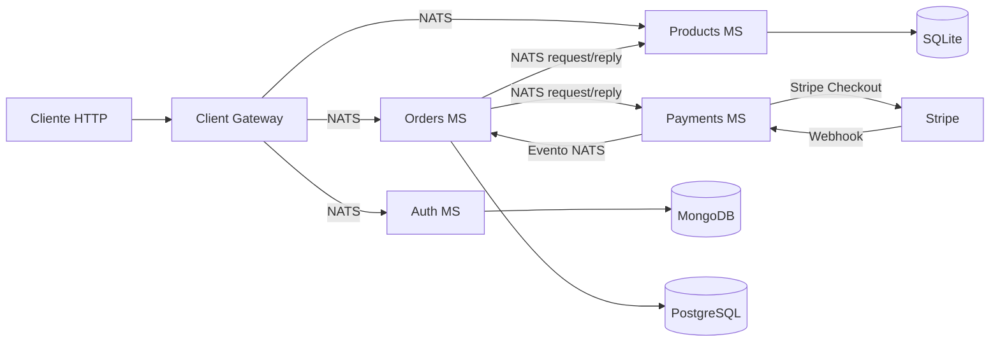

# Temario de repaso: microservicios con NestJS
## 1. Vista general del proyecto

El proyecto implementa una tienda como un conjunto de servicios NestJS independientes. El `client-gateway` expone la API HTTP para los clientes y se comunica con los microservicios mediante NATS. Los servicios se reparten las responsabilidades de autenticación, catálogo, órdenes y pagos.

### Flujo de compra

1. El cliente envía la solicitud al gateway.
2. El gateway valida la entrada y delega la operación por NATS.
3. Orders consulta Products para validar los productos y obtener sus datos.
4. Orders persiste la orden y sus ítems en PostgreSQL.
5. Orders solicita a Payments una sesión de Stripe Checkout.
6. Stripe notifica el resultado a Payments mediante un webhook.
7. Payments verifica la notificación y emite un evento NATS; Orders actualiza el estado de la orden.

## 2. Temario por bloques

### Bloque A — Fundamentos de NestJS y TypeScript

- Organización de una aplicación en módulos, controladores y servicios.
- Inyección de dependencias y separación de responsabilidades.
- DTOs para definir y validar datos de entrada.
- Pipes globales de validación con `class-validator` y `class-transformer`.
- Configuración de la aplicación y variables de entorno con `dotenv` y validación mediante Joi.
- Prefijos de rutas, manejo de excepciones y configuración del servidor HTTP con Express.

### Bloque B — Gateway y API REST

El gateway es el punto de entrada HTTP. Expone rutas de productos, órdenes y autenticación, y traduce las solicitudes del cliente en mensajes hacia otros servicios.

Rutas visibles en el código:

- Productos: `GET/POST /api/products`, `GET/PATCH/DELETE /api/products/:id`.
- Órdenes: `POST /api/orders`, `GET /api/orders`, `GET /api/orders/id/:id`, `GET /api/orders/:status`, `PATCH /api/orders/:id`.
- Autenticación: `POST /api/auth/register`, `POST /api/auth/login`, `GET /api/auth/verify`.
- Salud: `GET /`.
- Pagos expone además sus rutas HTTP propias: `GET /payments/success`, `GET /payments/cancel` y `POST /payments/webhook`.

### Bloque C — Microservicios y mensajería con NATS

- Conectar aplicaciones NestJS a un servidor NATS con `@nestjs/microservices` y el paquete `nats`.
- Separar transporte HTTP y transporte de mensajes.
- Usar `ClientProxy` para enviar solicitudes desde el gateway y entre servicios.
- Usar patrones de solicitud/respuesta (`MessagePattern`) cuando se necesita un resultado.
- Usar eventos (`EventPattern` y `emit`) para comunicar hechos asincrónicos, como la confirmación de un pago.
- Nombrar y mantener consistentes los patrones de mensajes entre quien publica y quien consume.
- Usar RxJS/Observables en la comunicación basada en mensajes de Nest.

### Bloque D — Catálogo y persistencia con Prisma

`products-ms` gestiona el catálogo: crear, listar, consultar, actualizar, eliminar y validar productos. La eliminación implementada es lógica: cambia la disponibilidad del producto en lugar de borrar físicamente el registro.

Conceptos y tecnologías:

- Prisma ORM, Prisma Client, modelos, generación del cliente y migraciones.
- SQLite como base de datos del catálogo en esta configuración.
- Campos de producto como nombre, precio, disponibilidad y fechas.
- Paginación y consulta por identificador.
- Uso de las operaciones del microservicio para que Orders valide y obtenga información de productos.

### Bloque E — Autenticación y autorización

`auth-ms` implementa registro, inicio de sesión y verificación de tokens. El gateway expone esas operaciones y usa un guard para validar el bearer token en la ruta de verificación.

Conceptos y tecnologías:

- MongoDB con Prisma para persistir usuarios.
- Hash de contraseñas con `bcrypt`; no guardar contraseñas en texto plano.
- Emisión y validación de JSON Web Tokens (JWT) con `@nestjs/jwt`.
- Secretos y expiración del token configurados por variables de entorno.
- Guards de NestJS y lectura del token enviado por el cliente.

### Bloque F — Órdenes y coordinación entre servicios

`orders-ms` coordina la creación de pedidos y conserva la información necesaria para su seguimiento.

- Validación de productos y consulta de sus datos mediante NATS.
- Persistencia de órdenes e ítems relacionados con Prisma y PostgreSQL.
- Estados de orden visibles en el modelo: `PENDING`, `PAID`, `DELIVERED` y `CANCELLED`.
- Consulta de órdenes, actualización de estado y respuesta al evento de pago.
- Coordinación con Payments para crear una sesión de Checkout.

### Bloque G — Integración de pagos con Stripe

`payments-ms` crea sesiones de Stripe Checkout a petición de Orders y recibe notificaciones de Stripe por HTTP.

- SDK de Stripe y configuración mediante variables de entorno.
- URLs de éxito y cancelación.
- Webhooks: recepción del cuerpo sin procesar y verificación de la firma.
- Publicación del evento de pago por NATS para desacoplar Payments de la actualización de la orden.
- Configuración de un endpoint de webhook de desarrollo para probar la integración.

### Bloque H — Contenedores y desarrollo local

- Dockerfiles de desarrollo y producción para los servicios.
- Docker Compose para levantar NATS, los microservicios y las bases de datos configuradas.
- Variables de entorno para puertos, conexiones a bases de datos, JWT y Stripe.
- Montaje del código fuente y modo watch para desarrollar dentro de los contenedores.
- Diferencia entre construir imágenes y levantar servicios.

El archivo [`docker-compose.yml`](docker-compose.yml) describe el entorno de desarrollo y [`docker-compose.prod.yml`](docker-compose.prod.yml) la construcción orientada a producción. Para iniciar desde una copia nueva, primero se inicializan los submódulos Git, luego se prepara el `.env` a partir de `.env.template`.

### Bloque I — Construcción y despliegue

- Imágenes de producción multi-stage basadas en Node.js; compilación de TypeScript y ejecución del artefacto compilado.
- Google Cloud Build para construir y publicar imágenes en Google Artifact Registry.
- Kubernetes: Deployments, Services, Ingress, Pods y Secrets.
- Helm: chart y plantillas para empaquetar los recursos de la tienda.
- Comandos `kubectl` para inspeccionar recursos, describir Pods y revisar logs.

Referencias del repositorio: [`K8s.README.md`](K8s.README.md), [`k8s/tienda/Chart.yaml`](k8s/tienda/Chart.yaml) y las plantillas bajo [`k8s/tienda/templates`](k8s/tienda/templates).

### Bloque J — Calidad y herramientas de desarrollo

Los paquetes incluyen configuración y scripts para:

- Jest, `ts-jest` y Supertest para pruebas unitarias y de extremo a extremo.
- ESLint para análisis estático y Prettier para formato.
- Nest CLI, TypeScript, `ts-node` y `tsconfig-paths` para desarrollo y compilación.

## 3. Mapa de servicios

| Servicio | Responsabilidad principal | Comunicación / persistencia |
|---|---|---|
| `client-gateway` | API HTTP y delegación de solicitudes | HTTP hacia el cliente; NATS hacia servicios |
| `auth-ms` | Registro, login y verificación JWT | NATS; MongoDB mediante Prisma |
| `products-ms` | Catálogo y validación de productos | NATS; SQLite mediante Prisma |
| `orders-ms` | Creación y seguimiento de órdenes | NATS; PostgreSQL mediante Prisma |
| `payments-ms` | Sesiones Checkout y webhook | HTTP con Stripe; NATS con Orders |
| NATS | Transporte de mensajes entre servicios | Solicitud/respuesta y eventos |

## 4. Tecnologías utilizadas

- **Lenguaje y plataforma:** TypeScript, Node.js.
- **Backend:** NestJS 10, Express y RxJS.
- **Mensajería:** NATS, `@nestjs/microservices`, `ClientProxy`.
- **Validación y configuración:** DTOs, `class-validator`, `class-transformer`, Joi y `dotenv`.
- **Persistencia:** Prisma ORM y Prisma Client; MongoDB, SQLite y PostgreSQL.
- **Seguridad:** JWT, `@nestjs/jwt`, bcrypt, guards y variables secretas.
- **Pagos:** Stripe Checkout y webhooks firmados.
- **Contenedores:** Docker y Docker Compose.
- **Cloud y despliegue:** Google Cloud Build, Google Artifact Registry, Kubernetes y Helm.
- **Pruebas y estilo:** Jest, `ts-jest`, Supertest, ESLint y Prettier.

